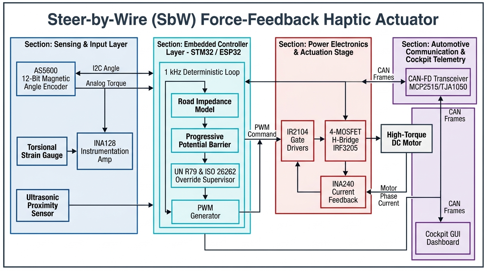
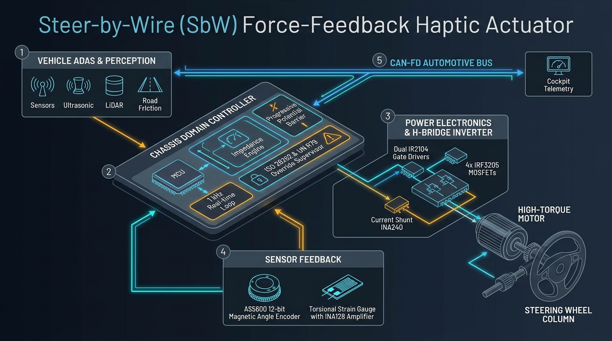

# Steer-by-Wire Dynamic Force-Feedback Haptic Actuator with Active Collision-Rejection Virtual Wall & Road Impedance Synthesis

[](https://opensource.org/licenses/MIT)
[](#)
[](#)

> **Submission for KPIT Technologies Innovation Challenge / Hackathon**  
> **Track:** In-Cabin Sensing, Driver Ergonomics & Cockpit Systems / Wearable Robotics & Simulation

---

## 📌 Overview

In modern **Steer-by-Wire (SbW)** and autonomous driving architectures, the physical mechanical steering column connecting the driver's hands to the road wheels is completely removed. Without physical linkage:
1. Drivers lose vital tactile road-surface feedback (caster spring return, tire friction, road texture).
2. Drivers risk accidentally steering into blind-spot obstacles or oncoming traffic during split-second autonomous takeover maneuvers without physical resistance.

This repository implements an **automotive-grade Force-Feedback Steering Actuator Bench Prototype** featuring:
- **Active Spring-Damper Mechanical Impedance:** Speed-dependent dynamic centering and damping mimicking real vehicle suspension physics.
- **Progressive Soft-Margin Repulsive Potential Field:** Warns the driver with escalating counter-torque *before* an unsafe lane boundary is crossed.
- **Functional Safety & Driver Override Protocol (ISO 26262 & UN R79 / ISO 11270):** Ergonomically clamped torque ceiling ($\approx 5\text{ Nm}$) with real-time panic override detection ($> 8\text{ Nm}$) to ensure the human driver always retains ultimate control.
- **Hardware-Level Sensor Integration & CAN Telemetry:** 12-bit magnetic rotary encoding, analog reaction torque strain-gauge amplification, and cyclic automotive CAN bus broadcasting.

---

## 🏗️ System Architecture



<p align="center">
  <em>Figure 1: Modular System Architecture illustrating the 4 distinct ECE cyber-physical domains and bus interactions.</em>
</p>



```
                  +-------------------------------------------------------------+
                  |                 VEHICLE SENSORS / ADAS SIMULATOR           |
                  |   (Ultrasonic / LiDAR Distance, Road Friction μ, CAN Bus)   |
                  +------------------------------+------------------------------+
                                                 | (CAN-Bus / UART Telemetry)
                                                 v
  +-----------------------------------------------------------------------------------------+
  |                        STEERING ACTUATION CONTROLLER (STM32F4 / ESP32)                 |
  |                                                                                         |
  |  +---------------------------+  +--------------------------+  +----------------------+  |
  |  |  Virtual Environment      |  |  Impedance & Admittance  |  | Functional Safety    |  |
  |  |  Model:                   |->|  Control Engine:         |->| & Watchdog Logic     |  |
  |  |  - Centering Spring Rate  |  |  τ_cmd = K(θ) + B(ω)     |  | - Current Clamping   |  |
  |  |  - Progressive Barrier    |  |          + τ_barrier     |  | - Human Override Det |  |
  |  +---------------------------+  +--------------------------+  +----------------------+  |
  +--------^-------------------------------------+----------------------------+-------------+
           |                                     | (Dual Complementary PWM)   |
           |                                     v                            |
+----------+------------+             +-----------------------+               |
|  SENSOR FEEDBACK LOOP |             | POWER DRIVER STAGE    |               |
|                       |             | (Discrete H-Bridge /  |               |
| 1. Reaction Torque:   |             |  Gate Drivers + FETs) |               |
|    Wheatstone Strain  |             +-----------+-----------+               |
|    Gauge + INA128 Amp |                         | (Bi-directional Current)  |
|                       |                         v                           v
| 2. Angle & Velocity:  |             +-----------------------+     +-----------------------+
|    AS5600 12-Bit      |             | HIGH-TORQUE MOTOR     |<--->| CURRENT SENSING AFE   |
|    Magnetic Rotary    |             | (Coupled to Steering  |     | (Shunt + INA240 /     |
|    Encoder (I2C)      |             |  Wheel Shaft)         |     |  ACS712 Overcurrent)  |
+-----------------------+             +-----------------------+     +-----------------------+
```

---

## 📐 Mathematical Formulation

The deterministic $1\text{ kHz}$ control loop calculates the commanded motor torque ($\tau_{\text{motor}}$):

```math
\tau_{\text{motor}} = \tau_{\text{centering}} + \tau_{\text{damping}} + \tau_{\text{barrier}} + \tau_{\text{haptic\_vibe}}
```

---

### 1. Spring-Damper Road Impedance

```math
\tau_{\text{centering}} = -K_p(v_{\text{veh}}) \cdot \theta
```

```math
\tau_{\text{damping}} = -B_d(v_{\text{veh}}) \cdot \omega
```

- **$\theta$:** Steering angle from center ($^\circ$ or $\text{rad}$)
- **$\omega = \frac{d\theta}{dt}$:** Angular velocity ($\text{rad/s}$)
- **Speed-Scaling:** At parking speeds ($10\text{ km/h}$), centering stiffness is low ($K_p \approx 0.02\text{ Nm/deg}$) for effortless maneuvering. At highway speeds ($120\text{ km/h}$), damping scales up ($B_d \approx 0.011\text{ Nm}\cdot\text{s/deg}$) to prevent over-steering and stabilize high-speed cruising.

---

### 2. Three-Zone Progressive Haptic Barrier

To prevent steering into blind-spot obstacles while complying with automotive safety standards, the steering field is segmented into three continuous angular zones:

```math
\tau_{\text{barrier}}(\theta, \omega) = \tau_{\text{zone}}(\theta) + \tau_{\text{damping}}(\omega)
```

#### Zone Breakdown

**Zone 1: Free Compliant Zone ($|\theta| < \theta_{\text{warn}}$)**

$$
\tau_{\text{barrier}} = 0
$$

*No artificial interference; normal steering feel.*

**Zone 2: Progressive Soft-Margin Warning ($\theta_{\text{warn}} \le |\theta| < \theta_{\text{limit}}$)**

$$
\tau_{\text{barrier}} = -K_1 \cdot \left(\frac{|\theta| - \theta_{\text{warn}}}{\theta_{\text{limit}} - \theta_{\text{warn}}}\right)^2 \cdot \operatorname{sgn}(\theta)
$$

*A parabolic repulsive potential field creates smooth, escalating stiffness before crossing the lane hazard.*

**Zone 3: High-Impedance Dissipative Barrier ($|\theta| \ge \theta_{\text{limit}}$)**

$$
\tau_{\text{barrier}} = -\min\Big(\tau_{\text{clamp}}, \; K_1 + K_2 \cdot (|\theta| - \theta_{\text{limit}}) + B_{\text{wall}} \cdot \max(0, \omega \cdot \operatorname{sgn}(\theta))\Big) \cdot \operatorname{sgn}(\theta)
$$

*Maximum assistive torque combined with asymmetric one-way velocity damping.*

> **💡 Asymmetric One-Way Damping ($\max(0, \omega)$):**  
> Damping only opposes motion moving **deeper** into the hazard ($\omega > 0$). When steering **back toward safety** ($\omega < 0$), barrier resistance immediately drops to zero, ensuring an effortless, natural recovery.

---

### 3. Human Override & Functional Safety (UN R79 / ISO 26262)

$$
\text{If } |\tau_{\text{human}}| > \tau_{\text{override}} \; (8.0\text{ Nm}) \quad \text{for } \Delta t > 150\text{ ms} \implies \tau_{\text{barrier}} \xrightarrow{\text{decay}} 0
$$

- **Ergonomic Safety Clamp:** Motor output is hardware-clamped to $\tau_{\text{clamp}} \le 5.5\text{ Nm}$ (preventing actuator stall current spikes, motor thermal burnout, and driver wrist strain).
- **Driver Override Mandate (UN R79 / ISO 11270):** If an onboard sensor produces a false positive, the driver can deliberately overpower the system ($> 8.0\text{ Nm}$). The controller detects sustained human effort via the inline strain gauge, immediately decays the barrier, and yields full steering authority back to the driver.

---

## 🛠️ Hardware Bill of Materials (BOM)

| Subsystem | Component Description | Interface / Specs |
| :--- | :--- | :--- |
| **Controller** | STM32F401 BlackPill / ESP32-S3 | 84–240 MHz, Hardware Timers, ADC/I2C/SPI |
| **Actuator Motor** | 12V Planetary Geared DC Motor | Stall Torque $> 3.5\text{ Nm}$, with shaft coupler |
| **H-Bridge Power Stage** | 4x IRF3205 N-FETs + 2x IR2104 Gate Drivers | $55\text{V}$, $110\text{A}$, $R_{DS(on)} < 8\text{ m}\Omega$, $500\text{ ns}$ dead-time |
| **Angle Sensor** | AS5600 Magnetic Rotary Encoder | 12-Bit Contactless ($0.087^\circ$), I2C Fast Mode |
| **Reaction Torque Sensor**| Dual-axis Strain Gauge + INA128 / HX711 | Wheatstone bridge, Gain $G=500$, Sallen-Key low-pass filter |
| **Current Sense AFE** | INA240 / ACS712-20A Hall Effect | Bidirectional current monitor, Overcurrent protection |
| **Automotive Comms** | MCP2515 SPI Controller + TJA1050 Transceiver | ISO 11898 Standard CAN 2.0B ($500\text{ kbps}$) |

---

## 📁 Repository Structure

```
.
├── README.md                          # Project documentation & overview
├── steer_by_wire_solution_doc.md      # Detailed engineering & mathematical solution doc
├── firmware/                          # MCU firmware (STM32 / ESP32)
│   ├── src/
│   │   ├── main.cpp                   # 1 kHz control loop, state machine
│   │   ├── impedance_controller.cpp   # Potential field, damping, virtual wall
│   │   ├── can_telemetry.cpp          # CAN frame generation & arbitration
│   │   └── sensor_drivers/            # AS5600, strain gauge AFE, INA240
│   └── include/
├── hardware/                          # Schematics & Circuit Designs
│   ├── schematics/                    # KiCad / PDF schematic files
│   └── bom.md                         # Detailed component sourcing guide
└── simulation/                        # Model validation
    └── virtual_steering_model.py      # Python simulation of impedance response
```

---

## 🚦 Live Demonstration Protocol (For Hackathon Jury)

1. **Natural Steering Feel:** The judge spins the wheel; the electronic spring-damper loop centers the wheel naturally without physical linkages.
2. **Speed Scaling:** Slider shifts simulated vehicle speed $10 \to 120\text{ km/h}$; the steering resistance dynamically tightens.
3. **Progressive Hazard Barrier:** Simulated obstacle on left lane triggers the soft-margin parabolic stiffness before reaching the line. Turning right remains compliant.
4. **Driver Panic Override:** Forcing the wheel past $8\text{ Nm}$ disengages the barrier, flashing an "Emergency Override Accepted" CAN frame to satisfy ISO 26262/UN R79 requirements.
5. **Rumble Strip & Oscilloscope:** Lane departure generates an $80\text{ Hz}$ vibrational buzz with live current waveforms on display.

---

## 📄 License
This project is open-source under the [MIT License](LICENSE).
